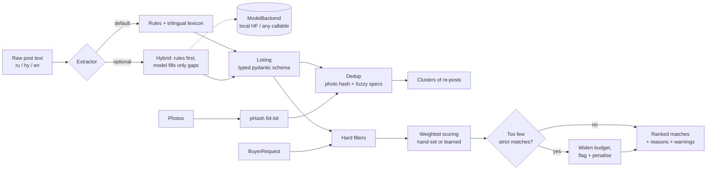

# multilingual-listing-intelligence

[](https://github.com/GEV44/multilingual-listing-intelligence/actions/workflows/ci.yml)
 

Turn messy **Russian / Armenian / English** real-estate posts into structured data, find the
same flat re-posted, and rank listings against a buyer's or renter's request **with an
explanation for every result**. Runs fully offline by default: no API keys, no model download.

## The problem

In Yerevan, flats are advertised in Telegram and Facebook groups in free text that mixes three
languages, several currencies (USD, AMD, RUB) and many ways to write the same fact
(`95 000$`, `95 тыс. $`, `95 հազար դոլար`; `5/9`, `5 этаж из 9`, `5-րդ հարկ, 9 հարկանի`).
The same flat is usually re-posted by several agents with a slightly different price and
re-compressed photos. A buyer wants: "2 rooms, Arabkir or Kentron, up to $700, pets OK" and a
short list they can trust, including *why* each flat is on it and what is still unverified.

## Architecture



The FastAPI service exposes `/extract`, `/match`, `/dedup` and `/health` over these stages.

## Quickstart

```bash
pip install -e ".[dev]"
pytest --cov                              # tests
python -m listing_intel.evaluation        # reproduce the numbers below (about 10 s)
uvicorn listing_intel.api:app_factory --factory --reload
```

Docker: `docker compose up --build`, then open <http://localhost:8000/docs>.

Configuration is typed (`pydantic-settings`, env prefix `LI_`): `LI_EXTRACTOR` (`rules` |
`hybrid`), `LI_DEDUP_THRESHOLD`, `LI_SPEC_ONLY_THRESHOLD`, `LI_PHOTO_HAMMING_MAX`,
`LI_USD_PER_UNIT` (JSON currency table; the built-in rates are illustrative, not live).

## API examples

`POST /extract`

```json
{"text": "Сдаётся 2-комнатная квартира, 55 кв.м, 3/9 этаж, Арабкир, пр. Комитаса, евроремонт, можно с животными, 600$ в месяц"}
```

```json
{"listing": {"deal_type": "rent", "price": 600.0, "currency": "USD", "rooms": 2,
  "area_m2": 55.0, "floor": 3, "floors_total": 9, "district": "Arabkir", "street": "Komitas",
  "renovation": "euro", "furniture": null, "pets": "allowed", "heating": null,
  "sources": {"deal_type": "rules", "...": "rules"}}, "extractor": "rules"}
```

`POST /match` takes a request and listings given as raw `text` or as ready `listing` objects:

```json
{"request": {"deal_type": "rent", "budget_max": 650, "rooms_min": 2,
             "districts": ["Arabkir", "Kentron"], "pets": true},
 "listings": [
   {"id": "a", "text": "Сдаётся 2-комнатная ... Арабкир ... можно с животными, 600$ в месяц"},
   {"id": "b", "text": "Վարձով է 2 սենյականոց Կենտրոնում, 60 քմ, 4/9, 680$ ամսական"},
   {"id": "c", "text": "Rent: 2-room flat, Avan, 400 USD per month"}]}
```

Real response (trimmed): `a` fits the budget, `c` is rejected for its district, and `b` is
only offered because fewer than `min_results` flats fit strictly, so the budget was widened:

```json
{"matches": [
  {"id": "a", "score": 0.718, "over_budget_pct": 0.0,
   "reasons": ["Within budget: ~600 USD/month vs 650 USD (8% under)",
               "In Arabkir, one of your districts", "Pets allowed"], "warnings": []},
  {"id": "b", "score": 0.550, "over_budget_pct": 0.046,
   "reasons": ["Over budget by 4.6% (within your 10% flex)", "In Kentron, one of your districts"],
   "warnings": ["Renovation level not stated", "Pet policy not stated"]}],
 "widened": true, "rejected": {"district": 1}, "n_candidates": 3}
```

`POST /dedup` takes listings (text or structured) plus optional hex pHashes of their photos
(`listing_intel.dedup.phash_bytes` computes them) and returns clusters of likely re-posts.

## Evaluation

All data is **synthetic and generated by `listing_intel/synth.py`**: no real listings, sellers,
phone numbers or photos are used anywhere. Posts come in two tiers: `standard` (phrasings the
lexicon was written for) and `hard` (for each field, 50% of the time a phrasing the lexicon
does *not* cover: spelled-out numerals, `у.е.`, unit-less areas, unusual district spellings).
Reproduce with `python -m listing_intel.evaluation --write docs/results.json --markdown docs/results.md`
(seed 7; 1000 extraction posts, 200 requests of which 100 are held out, 150 flats plus their look-alike twins).

<!-- RESULTS -->
### Extraction (rules extractor, field-level)

| field | precision | recall | F1 | support |
|---|---|---|---|---|
| deal_type | 0.999 | 0.959 | 0.979 | 1000 |
| price | 0.991 | 0.767 | 0.865 | 1000 |
| currency | 1.000 | 0.774 | 0.873 | 1000 |
| rooms | 1.000 | 0.771 | 0.870 | 955 |
| area_m2 | 1.000 | 0.749 | 0.856 | 900 |
| floor | 0.917 | 0.784 | 0.846 | 849 |
| floors_total | 1.000 | 0.707 | 0.828 | 727 |
| district | 1.000 | 0.937 | 0.967 | 872 |
| street | 1.000 | 1.000 | 1.000 | 547 |
| renovation | 1.000 | 0.759 | 0.863 | 636 |
| furniture | 1.000 | 0.712 | 0.832 | 500 |
| pets | 1.000 | 0.768 | 0.869 | 319 |
| heating | 1.000 | 0.750 | 0.857 | 408 |
| **micro-avg** | 0.991 | 0.808 | 0.890 | 9713 |

| slice | micro P | micro R | micro F1 | macro F1 |
|---|---|---|---|---|
| lang:en | 1.000 | 0.831 | 0.908 | 0.904 |
| lang:hy | 0.988 | 0.805 | 0.887 | 0.883 |
| lang:ru | 0.988 | 0.793 | 0.880 | 0.872 |
| tier:hard | 0.978 | 0.620 | 0.759 | 0.738 |
| tier:standard | 1.000 | 0.986 | 0.993 | 0.994 |

### Ranking (100 held-out synthetic requests)

| system | nDCG@5 | nDCG@10 |
|---|---|---|
| random (after hard filters) | 0.501 | 0.533 |
| price only (after hard filters) | 0.417 | 0.480 |
| hand-set weights | 0.746 | 0.723 |
| learned weights | 0.798 | 0.765 |
| hand-set weights, gold facts (upper bound) | 0.946 | 0.927 |

### De-duplication (394 posts of 204 flats, pairwise)

| method | precision | recall | F1 |
|---|---|---|---|
| photo pHash only | 1.000 | 0.580 | 0.734 |
| spec match only | 0.774 | 0.988 | 0.868 |
| combined (default) | 0.874 | 0.972 | 0.920 |
<!-- /RESULTS -->

How to read these honestly:

* **`standard` extraction scores are close to circular**: the same person wrote the lexicon and
  the generator. The `hard` tier is the more informative number, and it shows exactly where
  rules alone stop and a model fallback has to earn its keep.
* Precision stays very high because the rules abstain instead of guessing; the cost is recall.
* Ranking labels come from a hidden persona-utility function over the *gold* facts
  (`synth.true_relevance`), deliberately a different shape from the production scorer, plus
  noise. "Price only" loses to "random" because synthetic buyers' utility is not monotone in
  price (the cheapest flats are the smallest). That is an artefact of the synthetic world, not
  a finding about real buyers. Learned weights are fit on the first 100 requests and every
  system is scored on the other 100.
* The gap between "hand-set weights" and the gold-facts upper bound is the cost of extraction
  errors flowing downstream.
* De-duplication: `spec_only_threshold` (0.90) was chosen on a separate dev seed (11); the
  photo Hamming limit (10 of 64 bits) was fixed a priori. The dataset includes look-alike flats
  in the same building (hard negatives) and 20% photo-less posts.
* The optional model path (`HybridExtractor`) is unit-tested with a fake backend. It has **not**
  been benchmarked with real model weights.

## Design decisions and trade-offs

* **Rules first, model as a gap filler.** Rules are deterministic, instant and auditable; a model
  only fills fields the rules left empty, its JSON is validated by the same pydantic schema, and
  it can never overwrite a rules value. Each field records its `source`.
* **Abstain over guess.** `None` means "not stated". Hard filters never reject on an unknown
  field (except deal type and price, which cannot be verified); instead the response carries a
  `warnings` list ("Pet policy not stated") so the human can ask the seller.
* **Armenian is matched by stems**, not with a morphological analyser (case endings are glued to
  the word). It is cheap and works for the lexicon's vocabulary, but it will miss unlisted
  vocabulary and can over-match; a few known collisions are handled explicitly
  (`կենտրոն` vs `կենտրոնացված`, `ավան` vs `ավանդ`, `аван` vs `аванс`).
* **Photos decide, specs assist.** Look-alike flats in one building share specs but not photos,
  so a photo match is required to cluster when both sides have photos; specs alone must clear a
  stricter bar when photos are missing. pHash is implemented in ~10 lines of numpy (DCT) rather
  than adding a dependency.
* **Explainable scoring over a black box.** A linear score over nine [0, 1] features, so every
  result can be explained and the learned weights (non-negative logistic regression, normalised)
  can be read. No heavy ranker is justified at this data size.
* **Budget widening is explicit.** Over-budget flats appear only when fewer than `min_results`
  strict matches exist, within `widen_budget_pct`, are penalised and are labelled as such.
* **Currencies** are converted with a configurable static table; live FX is out of scope.

## Limitations

Yerevan-specific lexicon (12 districts, 12 streets); no geocoding; no phone/contact handling by
design; synthetic data cannot reveal real-world distribution shift; room counts use the local
"rooms" convention (a "3-bedroom" in English is not converted).

## Roadmap

- Benchmark a small local model behind `HybridExtractor` on the `hard` tier and publish the gap.
- Parse buyer requests from free text with the same extractor.
- Street/district gazetteer from OpenStreetMap, plus geographic distance as a feature.
- Active learning loop: store human corrections from the `warnings` flow and retrain weights.
- Persistent store and incremental dedup (LSH over pHashes) instead of all-pairs per call.

## Project layout

```
src/listing_intel/  schema, config, lexicon, extract/{rules,hybrid}, dedup, match, learn,
                    synth, evaluation, api
tests/              pytest suite (coverage gate 85%)
docs/results.*      latest evaluation output
```

MIT licensed. Quality gates: `ruff check`, `ruff format --check`, `mypy --strict`, `pytest --cov`
run in GitHub Actions on Python 3.10 and 3.12, plus a Docker build.
